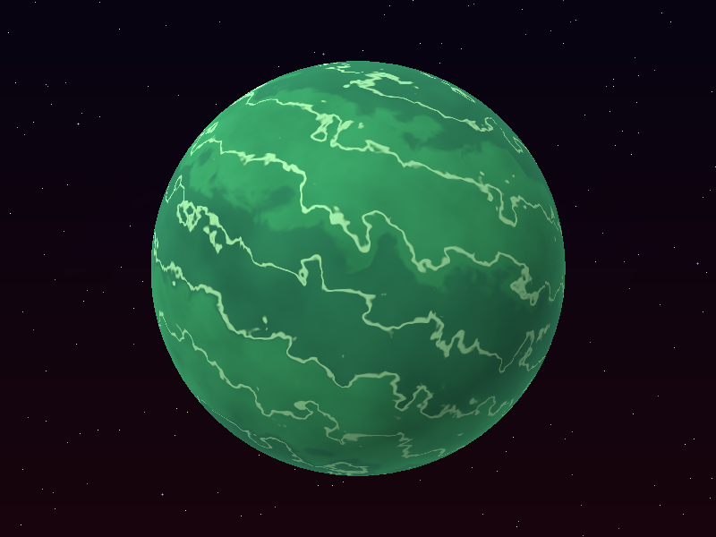
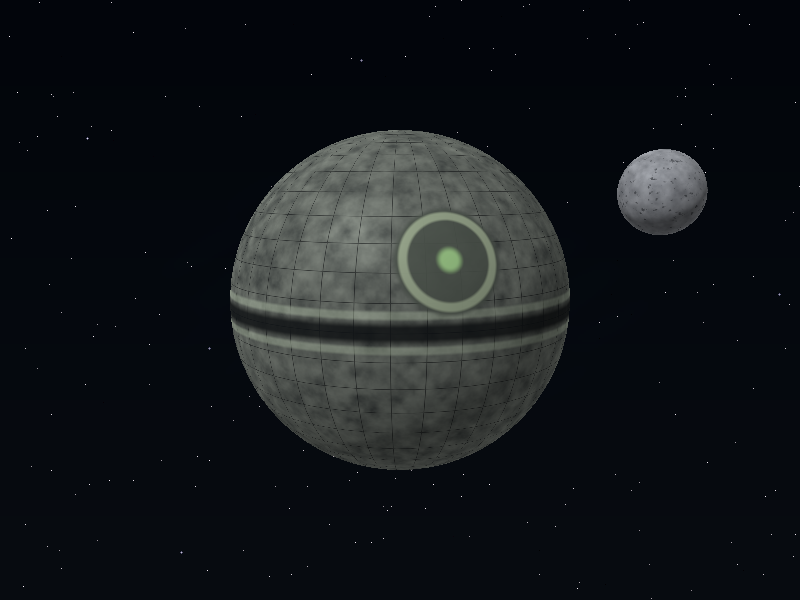
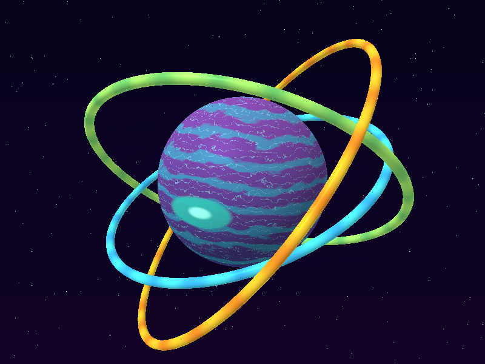
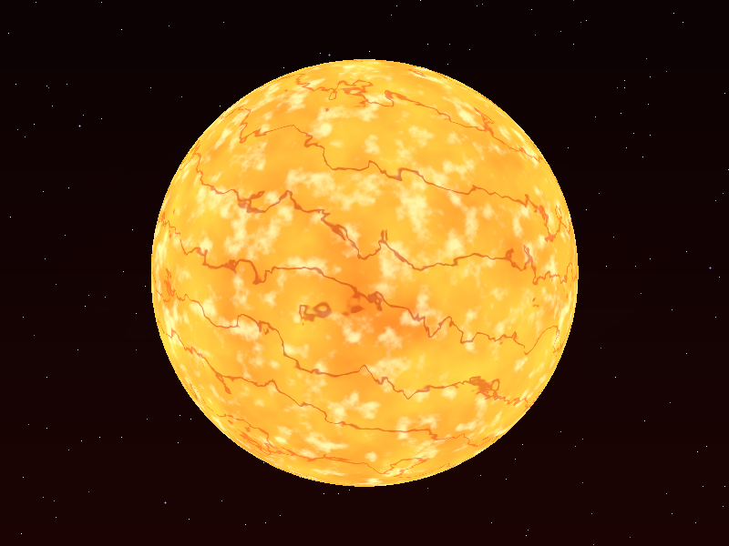

# Lab 5 — Shaders de cuerpos celestes

Software renderer escrito en Rust. Los colores se calculan por fragmento con shaders.

## Resultados

### 1. Viridia — planeta rocoso verde



### 2. Noctis — planeta rocoso mecánico



### 3. Azurón — gigante gaseoso con anillos



### 4. Helios — Sol



## Ejecución

Requiere Rust estable.

```bash
cargo run --release --bin celestial-shaders
```

Controles:

- `1`, `2`, `3`: cambiar entre los tres planetas.
- `4`: mostrar el Sol.
- `A`/`D` o `←`/`→`: orbitar horizontalmente.
- `W`/`S` o `↑`/`↓`: orbitar verticalmente.
- `+`/`-`: acercar o alejar la cámara.
- `Espacio`: activar o pausar la rotación; comienza pausada para ahorrar CPU.
- `R`: restablecer la cámara.
- `Esc`: salir.

## Capas de los shaders

Cada cuerpo requerido tiene al menos cuatro capas que afectan el color:

| Cuerpo | Capas principales |
|---|---|
| Viridia | ruido celular, regiones oscuras, filamentos, depósitos minerales e iluminación |
| Noctis | grano mineral, paneles, trinchera ecuatorial, plato circular e iluminación |
| Azurón | gradiente latitudinal, bandas turbulentas, nubes finas, contrabandas y tormenta oval |
| Helios | fotosfera, granulación, filamentos de plasma, zonas activas y corona |

## Render pipeline implementado

1. `model.rs` lee posiciones, normales y caras desde OBJ.
2. La aplicación prepara los uniforms: matrices Model/View/Projection, tiempo, cámara, luz y shader activo.
3. El vertex shader transforma cada vértice de espacio local a clip space y entrega posición y normal como varyings.
4. Las caras OBJ se triangulan y se recortan contra los seis planos del frustum con Sutherland–Hodgman.
5. El perspective divide lleva clip space a NDC y luego al viewport.
6. El rasterizador usa coordenadas baricéntricas e interpolación con corrección de perspectiva.
7. El fragment shader ejecuta las capas procedurales y devuelve el RGB final.
8. El z-buffer conserva el fragmento visible y el framebuffer se presenta en la ventana con `minifb`.

El rasterizado se divide en franjas horizontales y utiliza todos los procesadores lógicos disponibles. Cada hilo escribe en una región independiente del framebuffer y del z-buffer, sin reducir la resolución de 800×600 ni la complejidad de los shaders.
